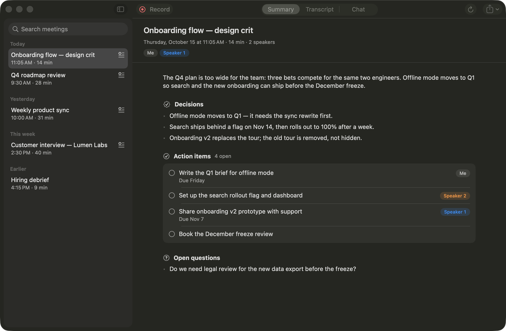
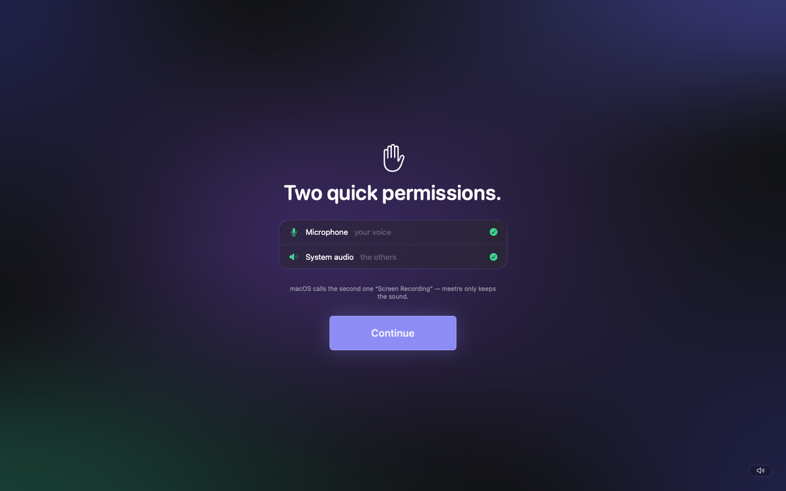
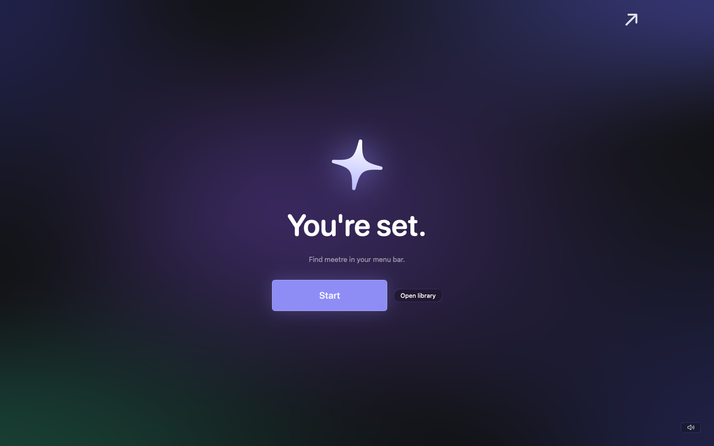
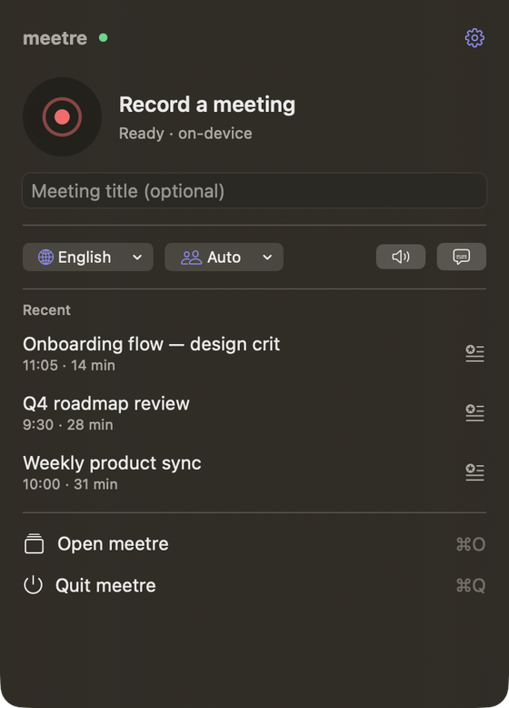
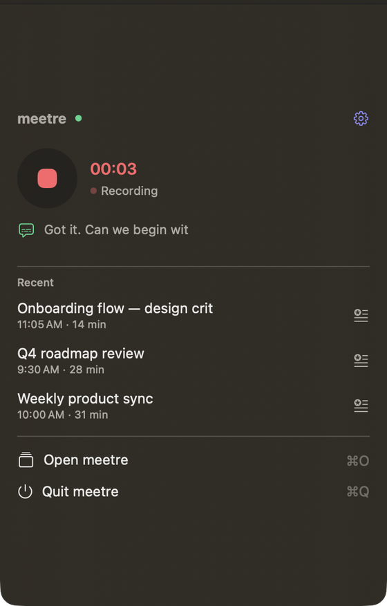
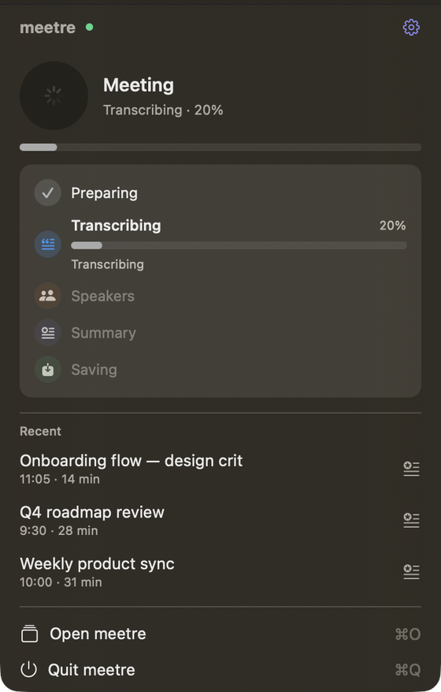
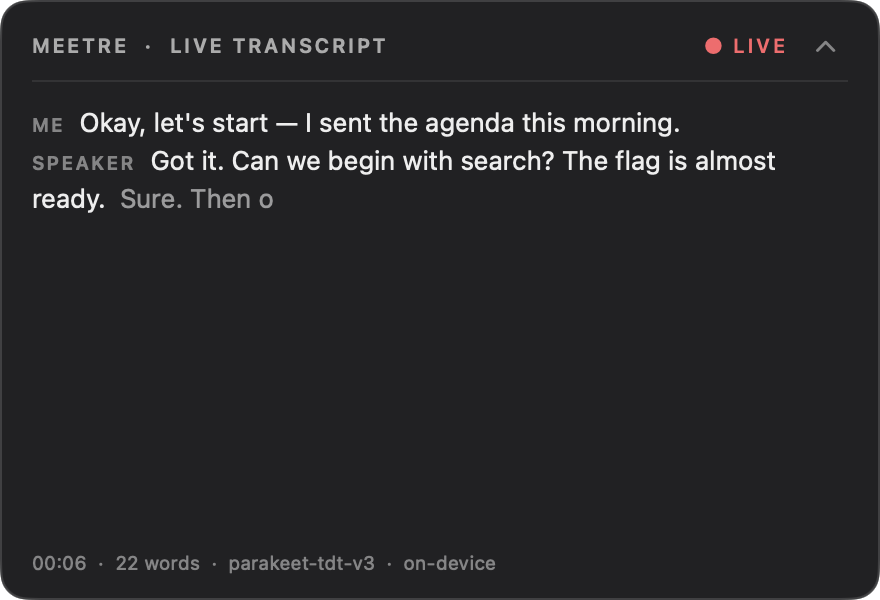
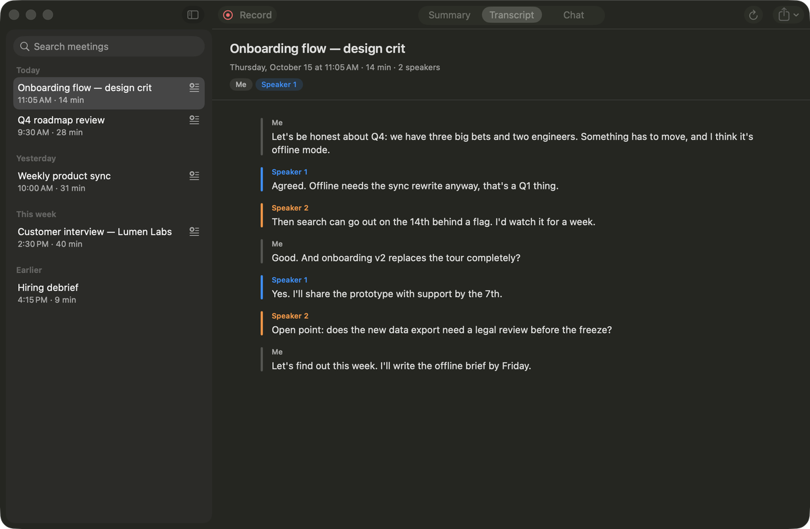
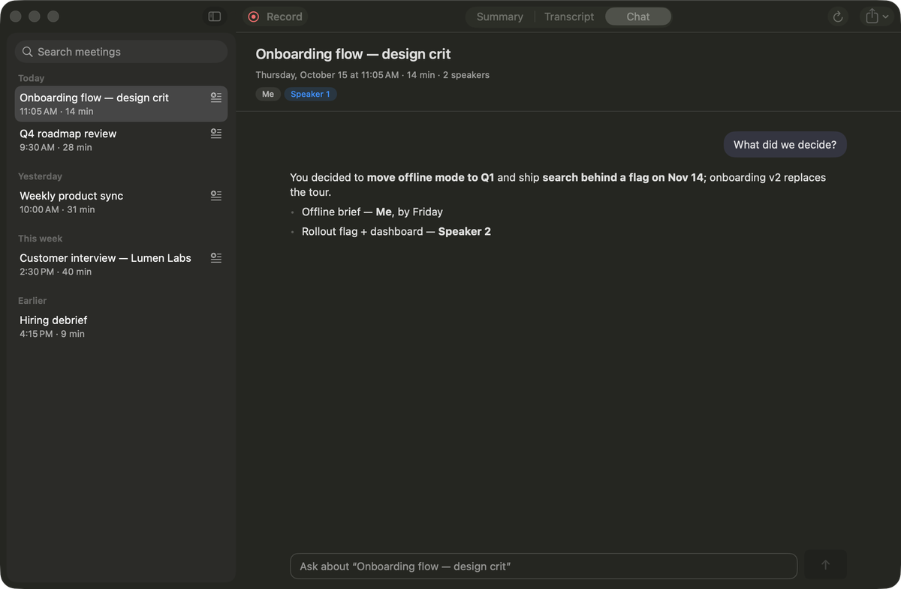
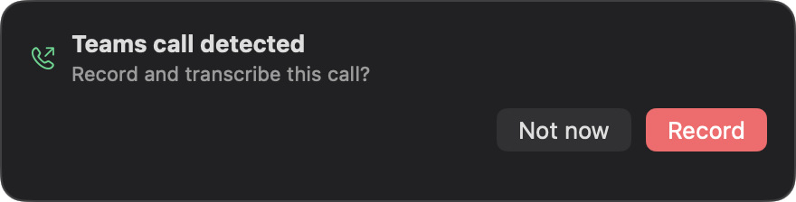

<div align="center">

# ✦ meetre

**Your meetings, written down. On your Mac. Nothing leaves it.**

Record any call or room conversation, get a speaker-labelled transcript and a
summary with decisions, action items and open questions — transcribed and
summarised entirely on-device on Apple Silicon.




</div>

---

## Install

One line in Terminal — no admin password, no accounts, no API keys:

```bash
cd ~ && curl -fsSL https://github.com/maxlkatze/meetre/archive/refs/heads/main.tar.gz | tar -xz && cd meetre-main && bash install.sh
```

It sets up the on-device engine, builds **Meetre.app** into `~/Applications`
(so it's in Launchpad and Spotlight) and opens it. A short introduction takes it
from there:

<table>
<tr>
<td width="33%"></td>
<td width="33%"></td>
<td width="33%"></td>
</tr>
<tr>
<td align="center"><sub>A few words, soft sounds</sub></td>
<td align="center"><sub>Microphone + system audio, explained</sub></td>
<td align="center"><sub>Find ✦ in your menu bar</sub></td>
</tr>
</table>

> **Needs** Apple's free Swift tools to build the app. If they're missing the
> installer tells you — run `xcode-select --install`, then the line above again.
>
> **Don't** install into `~/Downloads`, `~/Desktop` or `~/Documents`: macOS
> blocks login items from reading those folders. The command above uses your
> home folder, which is ideal.

### Already using meetre? Upgrading

**You don't need to do anything.** meetre updates itself when it starts; after
the next update + restart, the old menu-bar version builds the new Meetre.app in
the background, replaces its login item and Launchpad entry, and opens it.

Prefer to do it right now? In Terminal:

```bash
cd ~/meetre && git pull && bash install.sh     # or ~/meetre-main, wherever you installed it
```

Recordings in progress are safe: the installer refuses to quit meetre while it's
recording or processing a meeting.

---

## How it works

**1 · Record.** Click ✦ in the menu bar and press record — or accept the prompt
when a Teams call starts. meetre captures your microphone and the system audio
(everyone else on the call), no virtual audio driver needed.

<table>
<tr>
<td width="33%"></td>
<td width="33%"></td>
<td width="33%"></td>
</tr>
<tr>
<td align="center"><sub>Ready</sub></td>
<td align="center"><sub>Recording, with a live caption</sub></td>
<td align="center"><sub>Every step, in its own color</sub></td>
</tr>
</table>

**2 · Follow along.** Live captions float in a click-through panel in the
top-right corner — collapsed to a slim header by default, one click to expand.



**3 · Read what matters.** When you stop, meetre transcribes, works out who
said what, and writes a summary — then saves everything as Markdown and to
Apple Notes. The menu bar shows each step (preparing → transcribing → speakers →
summary → saving) and a green ✓ when it's done.

<table>
<tr>
<td width="50%"></td>
<td width="50%"></td>
</tr>
<tr>
<td align="center"><sub>Speaker-labelled transcript</sub></td>
<td align="center"><sub>Ask questions about any meeting</sub></td>
</tr>
</table>

---

## What's inside

| | |
|---|---|
| 🎙 **Mic + system audio** | Captured separately and mixed; system audio via ScreenCaptureKit — no BlackHole. If a call app switches your headset mid-meeting, the mic reconnects by itself. |
| ✍️ **Transcription** | NVIDIA **Parakeet TDT v3** on MLX (default, very fast) or Whisper (`large-v3-turbo` and smaller). Quiet voices are levelled up before transcription. |
| 👥 **Who said what** | Your side vs. the remote side from the separate recordings, then `pyannote` splits multiple speakers per side. Names are picked up from the conversation when they're clearly stated. |
| ✦ **Summaries** | A local LLM (**K2 Horizon 7B** by default) writes *Summary · Decisions · Action items · Open questions* — tuned and benchmarked on real meetings. The prompt is yours to edit. |
| 💬 **Chat** | Ask about any meeting ("what did we decide?"), with optional web search, file access and MCP tools. |
| 📞 **Call detection** | Offers to record when a Teams call starts, and to stop when it ends. |
| 🔒 **Private** | Audio and text never leave your Mac. No accounts, no telemetry. |



---

## Requirements

| | Minimum | Recommended |
|---|---|---|
| Mac | Apple Silicon (M1) | M3 or newer |
| macOS | 26 | 26 |
| Memory | 8 GB (smaller summary model) | 16 GB or more |
| Disk | ~6 GB for models | ~9 GB with speaker detection |

A 30-minute meeting typically transcribes in under a minute with Parakeet, and
summarises in about 15 seconds with K2 Horizon on an M-series Mac.

---

## Troubleshooting

**System audio isn't recorded / meetre keeps asking for Screen Recording.**
macOS gates system audio behind *Screen Recording* and applies it only after
the app restarts. Allow it once, let meetre restart, done — it stays allowed
across updates. If it seems stuck, reset it and allow again:
`tccutil reset ScreenCapture net.cubedpixels.meetre.app`.

**Something went wrong.** Open **Settings ▸ Advanced ▸ Error log** and press
**Copy error log** (or **Copy log** on any error banner) — it copies versions,
settings and the relevant errors, never transcripts or summaries. Paste it into
an issue. Full logs live in `~/Library/Logs/meetre/`.

**Restart meetre:** menu bar ▸ ↻ Restart meetre, or `meetre restart` in Terminal.

---

<details>
<summary><b>Speaker detection setup</b></summary>

Who-said-what works out of the box for *you vs. the others*. To also split
several remote speakers, meetre uses `pyannote/speaker-diarization-community-1`
(fully on-device). It needs a free Hugging Face token — accept the model terms at
`huggingface.co/pyannote/speaker-diarization-community-1` first, then paste the
token in the introduction, or:

```bash
meetre config hf_token <token>
meetre persons on
meetre speakers 3-6     # optional headcount hint: auto | 4 | 3-6
```

Labels: `Ich`/`Me` for you, `Vor Ort 1…`/`Local 1…` for several people in your
room, `Sprecher 1…`/`Speaker 1…` for remote participants.

</details>

<details>
<summary><b>Summary models</b></summary>

`auto` picks the best model that fits your Mac's memory. K2 Horizon 7B is
preferred; the rest are alternatives.

| Alias | ~Size | Best for |
|-------|-------|----------|
| `k2-horizon-7b` | 7.2 GB | default — excellent summary writing |
| `qwen3.5-4b` | 2.4 GB | 8 GB Macs, fast |
| `qwen3.5-9b` | 5.0 GB | balanced, fits 16 GB |
| `gemma4-12b` | 6.8 GB | strong multilingual |
| `gemma4-26b` | 14.5 GB | best German / multilingual |
| `qwen3.5-35b` | 20 GB | best all-round on 32 GB+ |
| `qwen3.5-122b` / `-397b` | 66 / 210 GB | Mac Studio |

```bash
meetre summary-model          # list models, sizes, and what fits
meetre summary-model auto     # best that fits (default)
meetre summary-model off      # transcript only
```

</details>

<details>
<summary><b>Command line</b></summary>

```bash
meetre                         # open Meetre.app
meetre restart                 # restart it (refuses while recording)
meetre record --name "Standup" # record + transcribe in the terminal
meetre transcribe call.mp3     # transcribe an audio file (MP3/WAV)
meetre summarize               # latest transcript → Apple Notes
meetre list | open | devices   # transcripts, folder, audio inputs
meetre model parakeet-tdt-v3   # or tiny … large-v3-turbo
meetre persons on|off          # speaker detection
meetre speakers 3-6            # headcount hint
meetre config [key value]      # view / change settings
meetre update                  # update now
```

Settings live in `~/.config/meetre/config.json`; transcripts in
`~/Documents/meetre/transcripts` (configurable).

</details>

<details>
<summary><b>Architecture & development</b></summary>

```
Meetre.app (SwiftUI, mac/)  ── JSON-RPC over stdio ──▶  meetre engine (Python, src/meetre/)
  menu bar · library · settings                           recording · Parakeet/Whisper · pyannote
  live overlays · onboarding                              K2 summaries · chat · Apple Notes
```

- Design rules: [`docs/DESIGN.md`](docs/DESIGN.md) · roadmap, protocol and the
  planned iCloud sync + iPhone companion: [`docs/ROADMAP.md`](docs/ROADMAP.md)
- Build the app: `bash mac/build.sh` → `mac/build/Meetre.app`
- UI without the engine: `MEETRE_FAKE_ENGINE=1 mac/.build/release/Meetre --open-library`
- Engine smoke test: `.venv/bin/python scripts/engine_smoke.py`

</details>

## Privacy

Recording, transcription, speaker detection and summaries all run locally (MLX,
PyTorch). Nothing is uploaded. The only network access is the one-time model
downloads from Hugging Face and meetre's own updates from GitHub.

## License

MIT — see [LICENSE](LICENSE).
